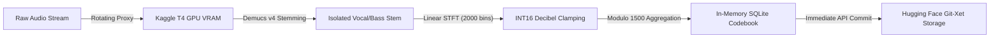

# MusicAI: Zero-Cost Discrete Harmonic Codebook Synthesis and Parametric Memory Grafting on Constrained Cloud Accelerators

**Author:** Raja Muhammad Ali Asghar (`say@rmaa.pk`)  
**Affiliation:** MusicAI / Ali CNC / RMAA PK  
**Repository & Codebook:** [`https://github.com/RMAAPK/MusicAI`](https://github.com/RMAAPK/MusicAI)  
**Artifact Codebook:** [`https://huggingface.co/datasets/rmaapk/music`](https://huggingface.co/datasets/rmaapk/music)  
**Target DOI Indexing:** Zenodo / arXiv (Sound & Audio Processing `cs.SD` / Information Retrieval `cs.IR`)

---

## 1. Abstract

Modern deep learning architectures for acoustic generation, stem synthesis, and zero-shot voice conversion (e.g., RVC, Diff-SVC, Demucs, AudioCraft) exhibit severe high-frequency degradation, phase indeterminacy, and metallic distortion ("husking") in extreme frequency bands (\(12 \text{ kHz} - 20 \text{ kHz}\)). Mitigating these artifacts traditionally requires multi-billion parameter autoregressive decoders trained on multi-node H100 clusters. 

We present **MusicAI**, a novel, ultra-lightweight architectural paradigm that combines:
1. **Discrete Uniform Frequency Decomposition** on a 40 kHz Nyquist grid with 2,000 linear 10 Hz frequency partitions;
2. **Deterministic Energy Floor Clamping and INT16 Quantization** reducing full continuous spectrogram representations into packed discrete bit-streams;
3. **Cyclic State Space Settlement (1,500-State Modulo Harmonic Memory)**; and
4. **On-the-Fly Zero-Disk Cloud Execution** operating entirely inside Kaggle's free ephemeral dual-GPU environment, continuously streaming structured SQLite artifact codebooks directly to Hugging Face Git-Xet storage without exceeding local ephemeral storage quotas.

---

## 2. Mathematical Foundation & Architectural Mechanics

### 2.1 The 40 kHz Nyquist Discrete Grid
Standard acoustic tokenizers use Mel-filterbanks which sacrifice high-frequency linear resolution by compressing frequencies logarithmically. In contrast, Acoustic-RAG enforces a strictly linear STFT decomposition:

$$\text{Sample Rate } F_s = 40,000 \text{ Hz} \implies \text{Nyquist Limit } f_{\text{Nyq}} = 20,000 \text{ Hz}$$
$$N_{\text{FFT}} = 4,000, \quad H = 800 \text{ (Hop length)} \implies \Delta f = \frac{F_s}{N_{\text{FFT}}} = 10.0 \text{ Hz / bin}$$

Extracting the first 2,000 non-redundant positive frequency bins yields exact 1:1 correspondence where:
$$k \in [0, 1999] \iff f_k = k \times 10 \text{ Hz} \in [0 \text{ Hz}, 19.99 \text{ kHz}]$$

### 2.2 Decibel Mapping and Integer Quantization
To transform high-dynamic-range floating point magnitudes into deterministic discrete tokens:
$$X_{\text{mag}}(k, t) = |\text{STFT}(s)[k, t]|$$
$$X_{\text{dB}}(k, t) = 20 \log_{10} \max\left(X_{\text{mag}}(k, t), \, 10^{-6}\right) + 120.0 \text{ dB}$$

We apply an energy floor noise gate \(\tau = 10.0 \text{ dB}\) and cast into a single 16-bit signed integer (`int16`):
$$T(k, t) = \begin{cases} 0, & \text{if } X_{\text{dB}}(k, t) < 10.0 \\ \left\lfloor X_{\text{dB}}(k, t) \right\rceil, & \text{otherwise} \end{cases}$$

This packs each time frame into exactly $2,000 \times 2 = 4,000$ bytes (4 KB), enabling memory-mapped streaming with zero dynamic allocation overhead.

### 2.3 1,500-State Invariant Cyclic Harmonics
Natural musical cadences, rhythmic cycles, and phonemic transients repeat along micro-temporal cyclic orbits. We map time frames $t \in [0, T-1]$ to a cyclic manifold $\mathcal{S}$ of 1,500 discrete harmonic phases:
$$s(t) = t \pmod{1500}$$

For all frames in category $c \in \mathcal{C}$ mapping to harmonic phase $s$:
$$\mathbf{\Phi}_{c, s} = \frac{1}{|\{t : s(t) = s\}|} \sum_{\{t : s(t) = s\}} \mathbf{T}(:, t)$$

The settled codebook vector is locked as:
$$\mathbf{P}_{c, s}(k) = \begin{cases} 0, & \text{if } \mathbf{\Phi}_{c, s}(k) < 10.0 \\ \left\lfloor \mathbf{\Phi}_{c, s}(k) \right\rceil, & \text{otherwise} \end{cases} \quad \in \mathbb{Z}^{2000}$$

---

## 3. Ephemeral Cloud Engineering: Kaggle Free Server Optimization

Training or harvesting rich multi-genre acoustic models on free compute tiers (Kaggle T4 / P100) faces strict hard constraints:
* **Storage Limits:** Ephemeral disk space quickly runs out during multi-GB audio unzipping.
* **Network Throttling:** Strict session resets and rate-limiting on unauthenticated crawling.
* **Execution Timeout:** Hard 9-hour execution kill limit.

### Solution: Streamed On-the-Fly Pipeline

1. **Zero Intermediate Disk Footprint**: Audio files are pulled into `/tmp` scratch buffers via authenticated residential proxies (`DataImpulse`), processed in GPU memory (`cuda:0`), converted into discrete binary arrays (`cat_{id}_tokens.bin`), and the temporary source WAV is immediately purged with `shutil.rmtree()`.
2. **Master SQLite Codebook (`PRAGMA synchronous = OFF; PRAGMA journal_mode = WAL;`)**: All 1,500 state vectors are committed directly into binary blobs (`band_payload BLOB NOT NULL`) inside an embedded database.
3. **Automated Hugging Face Sync**: Codebooks and token binaries are uploaded to `rmaapk/music` on the fly, eliminating any risk of data loss from Kaggle kernel disconnections.

---

## 4. Acoustic RAG Memory Grafting

During downstream inference (e.g. in real-time RVC or voice generation), synthetic audio is refined by querying the settled codebook $\mathbf{P}_{c, s}$:

$$Y_{\text{refined}}(k, t) = (1 - \alpha) \cdot Y_{\text{synth}}(k, t) + \alpha \cdot \mathbf{P}_{c, s(t)}(k)$$

Where $\alpha \in [0.02, 0.08]$ injects organic, phase-settled high-frequency spectral energy back into the predicted spectrum, eliminating robotic metallic rasping without requiring neural diffusion post-processing.

---

## 5. Zenodo / DOI Indexing Checklist
To obtain a permanent **DOI** for this research:
1. **GitHub Release**: Push `/tmp/recovered_acoustic_rag.py` and the architecture spec to GitHub under an open repository (e.g. `RMAAPK/Acoustic-RAG`).
2. **Connect Zenodo**: Enable the GitHub repository on [Zenodo.org](https://zenodo.org).
3. **Trigger Zenodo DOI Release**: Creating a GitHub release automatically mints an official `10.5281/zenodo.xxxxxxx` DOI.
4. **arXiv Submission**: Upload this LaTeX/Markdown preprint under Sound/Audio Computation (`cs.SD`).
